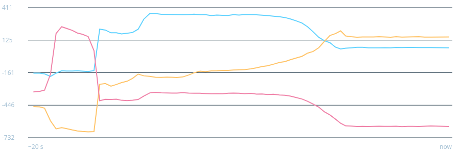

# STM32F303 Magnetometer sensor monitor

Read the STM32F3DISCOVERY's internal temperature sensor, VREFINT and onboard motion sensors with bare-metal C firmware, GDB and a local Go dashboard. The dashboard plots the magnetometer, gyroscope and accelerometer axes, estimated die temperature and estimated VDDA over the latest 20 seconds. The board's eight LEDs also display the estimated die temperature in binary.



## Hardware and requirements

- STM32F3DISCOVERY (MB1035) with an STM32F303VCT6 and onboard ST-LINK.
- ARM embedded GCC (`arm-none-eabi-gcc`), OpenOCD and an ARM-capable GDB (`arm-none-eabi-gdb`, or `gdb` with ARM support).
- Go 1.27.3 or newer to build the dashboard (see [cli/go.mod](cli/go.mod)). Go is not needed to read values directly with GDB.
- A USB connection to the board's ST-LINK and appropriate permissions to access it.

The firmware supports the L3GD20/I3G4250D gyroscope and LSM303DLHC/LSM303AGR accelerometer and magnetometer combinations fitted to STM32F3DISCOVERY revisions. It uses PA5–PA7 and PE3 for the gyroscope and PB6–PB7 for the accelerometer and magnetometer. If a sensor is unavailable, check the board revision and reset the board after flashing.

## Build and flash

From the repository root, connect the board through ST-LINK and run:

```sh
make build
make flash
```

`make build` produces `blink.elf`. Keep this file matched to the firmware flashed on the board; GDB uses its symbols to read measurements. `make flash` uses the supplied OpenOCD configuration.

## Live dashboard

With the board connected and running the matching firmware, start the monitor from the repository root:

```sh
cd cli
go build -o adc-stats .
cd ..
./cli/adc-stats
```

Open <http://127.0.0.1:8080>. The dashboard shows magnetometer, gyroscope and accelerometer X, Y and Z values, followed by the calibrated temperature estimate and estimated VDDA. Motion readings are raw signed register values, not calibrated physical units. Each motion chart has its own scale, and gaps indicate unavailable readings. The raw ADC counts and latest motion values are also displayed.

The monitor starts OpenOCD and briefly halts the target for each GDB reading, then resumes it. It attempts a reading every 100 ms, although GDB, USB and browser scheduling can make the interval longer. The charts show the latest readings, not every conversion. Stop the monitor with Ctrl-C.

Use `-gdb arm-none-eabi-gdb` if the default `gdb` does not support ARM. Run `./cli/adc-stats -h` for options, including `-existing-server` for an already running GDB server and `-listen` to change the web address. Alternatively, run directly from the repository root:

```sh
go -C cli run . -elf ../blink.elf -config ../stm32f3.cfg
```

## Measurements and LEDs

The firmware samples the internal temperature sensor and VREFINT sequentially, discarding the first ADC conversion after each channel change. Their latest raw 12-bit counts are available as `last_temp_adc` and `last_vref_adc`; the two readings have slightly different ages. The dashboard uses factory calibration words to estimate temperature and VDDA. The temperature is an estimate of **die temperature**, not ambient temperature. Invalid calibration data or a zero VREFINT reading makes the affected estimates unavailable.

The eight LEDs display the calibrated temperature rounded to the nearest whole degree Celsius as a signed 8-bit two's-complement number. Bit 0 is PE13, followed by PE14, PE15, PE8, PE9, PE10, PE11 and PE12 (bit 7). For example, 25 °C lights bits 0, 3 and 4. Values outside −128 to 127 °C are clamped. Invalid calibration or a zero VREFINT reading turns all LEDs off, which is indistinguishable from 0 °C.

Motion vectors are raw X, Y and Z register values. Accelerometer values are left-aligned; magnetometer formats differ by device. The `sensor_status` bits 0, 1 and 2 indicate valid gyroscope, accelerometer and magnetometer readings. `gyro_id` contains the detected WHO_AM_I byte; `mag_type` is 1 for LSM303DLHC, 2 for LSM303AGR or 0 if unknown. GDB can halt the firmware while it is updating a reading.

## Read values with GDB

To inspect readings without the Go dashboard, start OpenOCD in one terminal:

```sh
openocd -f stm32f3.cfg
```

In another terminal, start an ARM-capable GDB from the repository root:

```sh
gdb blink.elf
```

At the GDB prompt:

```gdb
target extended-remote localhost:3333
print last_temp_adc
print last_vref_adc
print last_gyro
print last_accel
print last_mag
print sensor_status
continue
```

Connecting halts the target. To take another reading, interrupt execution with Ctrl-C and print the variables again. Use `monitor resume`, then `detach` and `quit` to disconnect. Stop OpenOCD with Ctrl-C.

For a single noninteractive reading while OpenOCD is running:

```sh
gdb --nx --quiet --batch blink.elf \
  -ex 'target extended-remote localhost:3333' \
  -ex 'print last_temp_adc' \
  -ex 'print last_vref_adc' \
  -ex 'monitor resume' \
  -ex 'detach'
```

## License

[MIT](LICENSE).
